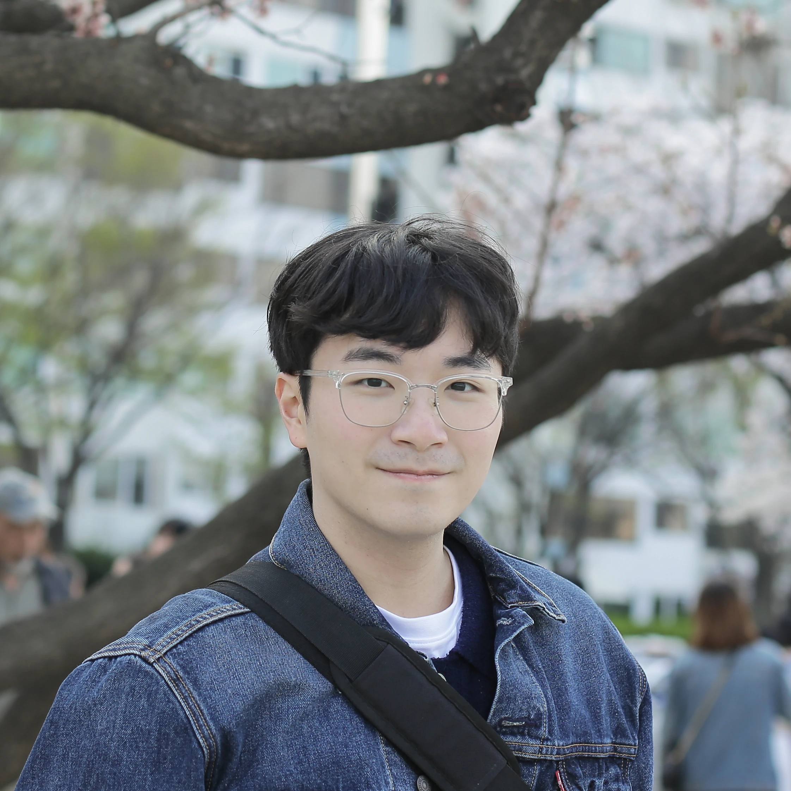

:::::: {.profile}
::: {.profile-image}

:::

::: {.profile-text}
# Ph.D. Student @ [CompSec](https://compsec.snu.ac.kr)

- Department of Electrical and Computer Engineering
- Seoul National University (SNU)

# Contact

- [jdal3031@snu.ac.kr](mailto:jdal3031@snu.ac.kr)
- [PGP Key](/files/jonguk.pgp)
- [GitHub](https://github.com/jongukc)

<!-- - [CV](/files/CV.pdf) -->
:::
::::::

# Bio

I am a Ph.D. student in the [CompSec Lab](https://compsec.snu.ac.kr) at Seoul
National University, advised by Prof. [Byoungyoung Lee](https://lifeasageek.github.io).

My research interests lie in systems security, with a focus on
LLM serving systems and confidential computing.

# Publications

::: {.pubs}
## 2026

- **[KVGuard: A KV Cache Safety Checker for LLM Serving Systems](https://arxiv.org/abs/XXXX.XXXXX)**\
  **Jonguk Cheong**, Myungbin Hwang, Eulgyu Kim, and Byoungyoung Lee\
  *arXiv preprint 2026*

<!--
- **OpenTDX: An Open Platform for Exploring Intel TDX**\
  Jaewon Hur, **Jonguk Cheong**, Scott Constable, Marcela S. Melara, Mona Vij, Taesoo Kim, and Byoungyoung Lee\
  *European Conference on Computer Systems (**EuroSys**) 2026* — *Under review*\
  [docs](/files/papers/opentdx-paper.pdf){.icon} [desktop_landscape](/files/slides/opentdx-slide.pdf){.icon} [format_quote](/files/bib/opentdx.bib){.icon}
-->
:::

# Talks

::: {.pubs}
- **KVGuard: A KV Cache Safety Checker for LLM Serving Systems**\
  *Intel Academic Security Conference, Hillsboro, 2026*
:::
